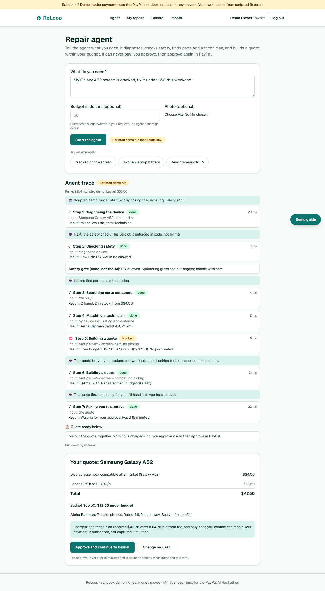
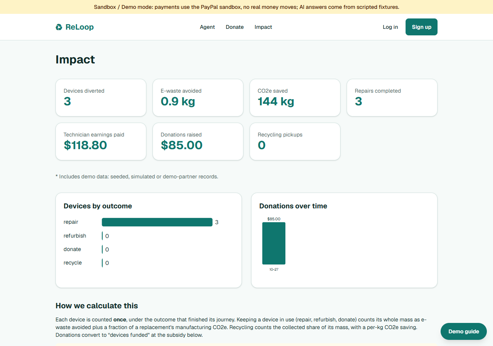
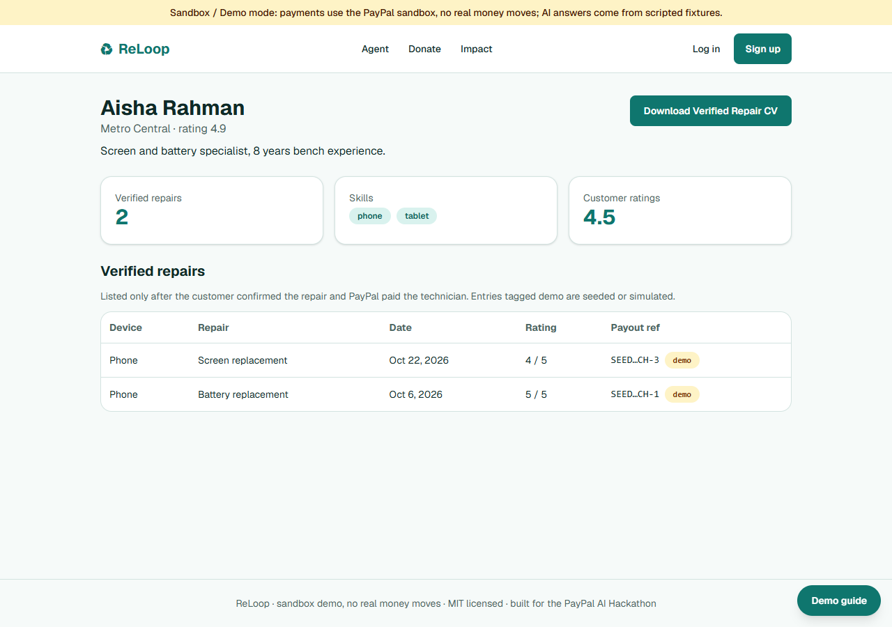
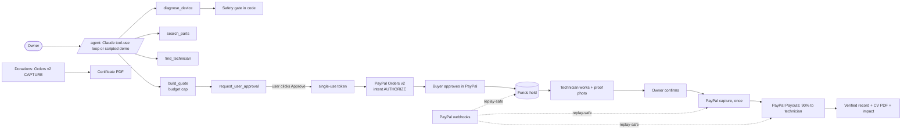

# ReLoop

[](LICENSE)

**An AI repair agent that finds a safe, in-budget fix for a broken device, lets only *you* approve it, holds the payment in PayPal, and pays the technician only after you confirm the repair.**

> **Sandbox demo.** Everything uses the PayPal **sandbox**: no real money moves, and nothing here is a real repair shop or recycler. Built for the PayPal AI Hackathon.
> Hosted demo: `https://<your-service>.onrender.com` *(placeholder; see [docs/deploy.md](docs/deploy.md))*. The free host sleeps: **open the link a minute before judging.**

| Agent run with budget and quote | Impact dashboard | Verified technician profile |
|---|---|---|
|  |  |  |

*(Screenshots were taken from a production build in demo mode, so the banner says PayPal is simulated locally. The landing page is in [docs/screenshots/landing.png](docs/screenshots/landing.png).)*

## The problem and who it is for

Most broken devices become e-waste because people can't tell whether a fix is safe or worth it, don't trust unknown repairers, and have no safe way to pay before the work is done. Skilled young technicians can't prove their track record. ReLoop is for **device owners** who want a trustworthy, affordable fix, **local technicians** (including trainees) who want to be paid fairly and build a verified record, and **communities** who want leftover devices refurbished, donated or recycled.

## What it does

1. **Agent** (`/agent`): type a goal ("My Galaxy A52 screen is cracked, fix it under $60 this weekend"). The agent diagnoses, checks safety, searches parts, matches a technician and builds a quote within budget, showing every step live.
2. **You approve, PayPal holds**: only your click unlocks PayPal checkout. The payment is *authorized*, not captured.
3. **Technician dashboard**: accept, work, complete with a proof photo.
4. **You confirm**: the payment is captured once and the technician is paid out (90%) through the PayPal Payouts API. Their **verified record** and a downloadable **CV PDF** grow.
5. **Beyond repair**: donate to the Refurbish & Donate Fund (PayPal, with a certificate PDF) or book a recycler pickup; the **impact dashboard** counts each device once.

## Architecture



More detail: [docs/architecture.md](docs/architecture.md).

## Exactly how PayPal is used (all sandbox)

| Where | API | What for |
|---|---|---|
| Checkout | Orders v2, `intent: AUTHORIZE`, JS SDK popup, plus full-page redirect fallback | Hold the buyer's money; amounts always come from our database, never the browser |
| Confirmation | Payments v2: capture (`PayPal-Request-Id` per job), re-authorize after the 3-day honor period, void on cancel | Capture exactly once, only when the owner confirms |
| Technician pay | Payouts API (`sender_batch_id` per job) | 90% share in integer cents; retry-safe; falls back to a labelled *simulated* payout if Payouts isn't enabled |
| Donations | Orders v2, `intent: CAPTURE`, own SDK namespace | Immediate capture, once; certificate only after capture |
| Webhooks | `PAYMENT.AUTHORIZATION.CREATED/VOIDED`, `PAYMENT.CAPTURE.COMPLETED`, `PAYMENT.PAYOUTS-ITEM.*` | Replay-safe safety net and async payout results |
| Agent gate | Our REST wrapper (the PayPal Agent Toolkit was evaluated, see `DECISIONS.md` 54) | The model has no tool that can create an order, authorize, capture or pay; a human-minted single-use token bound to job, total and line items (15 min) is required |

## Exactly how AI is used

- **Diagnosis** (Claude structured output, zod-validated): causes, severity, safety risk, recommended path, parts and labour estimate.
- **Safety gate** (plain code, not a prompt): DIY is only allowed for minor, low-risk problems; a model suggesting DIY for a swollen battery is overridden and the override is shown.
- **DIY guide** generation (refused in code when DIY isn't allowed).
- **Repair agent**: Claude tool-use loop (max 10 tool calls, 90 s timeout) over deterministic tools; goal text, photos and tool results are treated as untrusted data; budget and approval are enforced server-side.
- **Scripted fallback**: with `DEMO_MODE=true` or no API key, diagnosis uses fixtures and the agent plays a clearly labelled *scripted demo run* of three scenarios **through the same real tools and checks**. A daily cap on live calls (`AI_DAILY_CALL_CAP`) falls back to this with a notice.

## Accounts, guest mode and the two demo buttons

**Accounts.** Sign up at `/signup` as an **Owner** (has a broken device) or a **Technician** (skills, area and a PayPal *sandbox* email for payouts). Log in at `/login`. Passwords are 10 to 128 characters and are hashed with scrypt; sessions are server-side with a 7-day sliding expiry. This is a sandbox: **use a throwaway password**. See [SECURITY.md](SECURITY.md).

**Continue as guest (demo).** Judges do not have to sign up. The button on `/signup` and `/login` creates a real, temporary owner account (named like "Guest 4821") with a normal session, so every feature works. Guests and their data are deleted after 24 hours.

**Demo accounts** (seeded; shown in the *Demo guide* drawer):

| Role | Email | Password |
|---|---|---|
| Owner | `owner@reloop.demo` | `reloop-demo-2026` |
| Technician (Aisha Rahman) | `tech@reloop.demo` | `reloop-demo-2026` |

The password is public by design (the accounts hold demo data only). To change it, set `DEMO_ACCOUNT_PASSWORD` (at least 10 characters) and restart. The other seeded technicians have accounts with no usable password.

**Guided demo (two buttons, same tour).** On the hosted demo (or any run with `DEMO_ACTIONS=true`) there is **"Run guided demo (about 3 minutes)"** on the home page and on the signup page. It operates the real app, with a caption bar explaining each step: the agent run and budget block, the approval gate, a technician accepting and completing a job with a proof photo, the owner confirming, the payout, the safety stop, and the verified profile, donation and impact pages. Controls: pause, skip chapter, speed 1x/1.5x/2x, stop (Esc).

- **On `/signup`:** adds a short opening chapter that points at the signup form and the Owner / Technician choice and explains each role. It never types into or submits the form and never creates a user. When the tour finishes **or is stopped**, you are sent back to `/signup`.
- **On `/` (home):** the same tour, and afterwards you stay exactly as you were: a logged-in user is still logged in (same session cookie, untouched), a guest is still the same guest, a logged-out visitor is still logged out, and you are back on `/`. Your own devices and jobs are not shown in the tour and are never modified or counted.

During a tour the caption bar says **"Viewing as: Technician (tour)"** or **"Owner (tour)"** when the tour switches sides. That is a separate, tour-only identity (see [docs/DEMO_TOUR_NOTES.md](docs/DEMO_TOUR_NOTES.md)); it never reads or changes your real login. Everything the tour creates is labelled, excluded from totals and deleted when it ends.

## What is simulated in demo mode

| Part | Demo mode (no keys) | With keys |
|---|---|---|
| AI diagnosis and agent | Scripted fixtures, labelled | Live Claude |
| PayPal checkout | Local simulation, banner says so | Real PayPal sandbox |
| Payout | Labelled *simulated* | Sandbox Payouts if enabled |
| Donations | Local simulation (off in production without PayPal) | Real PayPal sandbox |
| Recycler | Always a demo partner; "Demo control" buttons (`DEMO_ACTIONS=true`) stand in for it | same |
| Dev "Simulate buyer approval" | Local dev only; never in production | same |
| Guided demo money | `TOUR-SIMULATED` payment, capture and payout; PayPal never called | same (still never called) |

Anything simulated is tagged **SIMULATED** in the UI and database.

## Run it

**Demo mode** (no keys, 4 commands):

```bash
git clone https://github.com/hafeza-zainab/E-Waste-Management.git reloop && cd reloop
cp .env.example .env          # Windows PowerShell: Copy-Item .env.example .env
npm run setup                 # install, generate Prisma client, migrate, seed
npm run dev                   # http://localhost:3000
```

**Real mode**: edit `.env` and set `PAYPAL_CLIENT_ID`, `PAYPAL_CLIENT_SECRET` (sandbox app), optionally `PAYPAL_WEBHOOK_ID`, and for live AI `ANTHROPIC_API_KEY` with `DEMO_MODE=false`. `npm run paypal:check` verifies your sandbox credentials (never prints the secret). Checks: `npm test`, `npm run typecheck`, `npm run lint`, `npm run build`. Production mode locally: `npm run build && npm start`. Wipe and reseed the local database: `npm run db:reset`.

### PayPal sandbox buyer (for checkout)

Log in to the PayPal popup with the sandbox **Personal** buyer (never the Business account):

- Email: `<sandbox buyer email>` *(set in `NEXT_PUBLIC_DEMO_BUYER_EMAIL`)*
- Password: `<fill in before submission>`

Dashboard checklist (Payouts, webhook, buyer account): [docs/deploy.md](docs/deploy.md).

## Authorization timing (verify against the live PayPal docs before submission)

PayPal authorizations have a 3-day honor period and are valid 29 days. The app re-authorizes after day 3 before capturing; at day 29 or if PayPal reports it voided/expired, the job becomes `authorization_expired` and nothing is charged.

## Verification (what was actually run)

From a fresh clone in a temp folder, following these commands: `npm run setup` (migrations + seed OK), `npm test` (all pass), lint clean, `npm run build` OK, `next start` in production mode. In that production build, with a real browser (Microsoft Edge via Playwright) at 360/412/768/1280 px: no horizontal overflow on landing, diagnosis, job, technician, agent, donate, impact, tech profile and 404; no serious/critical axe-core accessibility violations; a keyboard-only run of the agent flow (example, approve, pay) passed; the dev "Simulate buyer approval" is absent and the startup self-check logged and ignored `PAYPAL_SIMULATE_APPROVAL=true`; with sandbox credentials the PayPal SDK loads under the CSP and both the popup and the in-tab redirect reach `sandbox.paypal.com/checkoutnow`. Repeat with `BASE_URL=http://localhost:3200 npm run verify:ui` (it logs in with the demo accounts, then also runs `npm run verify:tour` and `npm run verify:auth`, each on its own throwaway server). Not run: Lighthouse (the tool produced no result with Edge), a full real-buyer approval, the hosted Render deployment. See [docs/judge-checklist.md](docs/judge-checklist.md).

## Testing

`npm test` runs ~260 Vitest tests: accounts (password hashing, sessions, cookie flags, CSRF origin checks, rate limits, open-redirect protection, guests and their purge, transactional technician signup), an authorization matrix across owner / other owner / technician / other technician / guest / anonymous for every page, route and action that returns or changes user data, the tour identity overlay, the Phase 7 to accounts migration, state machine and per-action role enforcement, capture/payout idempotency and expiry, webhooks, donations and certificate gating, PDFs, impact totals, the agent (tool schemas, 10-call cap, timeout, approval-token rules, budget, prompt injection, scripted traces), rate limiting, startup safety, CSP headers and colour contrast.

## Known limitations

- **No email verification and no password reset.** Anyone can sign up with any email address, and a forgotten password cannot be recovered (create a new account or use guest mode). Signup says when an email is already taken, which reveals that it exists (accepted trade-off for a demo; login never reveals it).
- **Sandbox data resets on redeploy.** Accounts, devices, jobs and uploaded photos live in SQLite on an ephemeral disk. Use a throwaway password.
- Guest accounts cannot be upgraded to a full account yet; "Create an account to keep your data" just links to signup.
- SQLite on an ephemeral disk: the hosted demo's data and uploaded photos reset on redeploy or restart.
- Rate limits and the daily AI cap are in memory (one instance only).
- Impact figures are **illustrative estimates with no verified sources** (labelled in the UI).
- The recycler and donation beneficiary are demo placeholders; certificates are not tax receipts.
- `npm audit`: one high advisory in the Prisma 6 CLI's `deepmerge-ts` (build-time tool); fix needs Prisma 7 (see SECURITY.md).
- The CSP allows inline scripts (required by Next.js without nonces).
- Real sandbox payouts need Payouts enabled and a real sandbox recipient email; otherwise they are simulated or show UNCLAIMED.

## Future work

Email verification, password reset and guest-to-account upgrade, KYC for technicians, a shared store for rate limits, Postgres, dispute handling, real recycler and charity integrations, sourced impact factors.

## License

MIT, see [LICENSE](LICENSE). Security notes: [SECURITY.md](SECURITY.md). Design decisions: [DECISIONS.md](DECISIONS.md).
